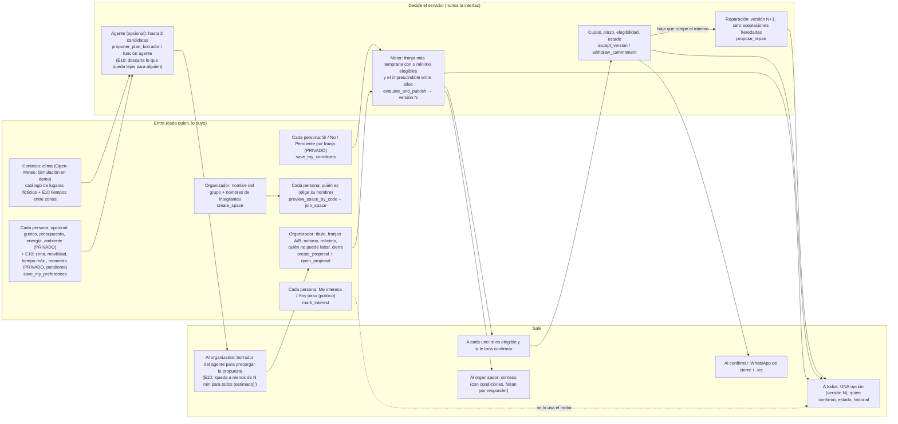

# Flujo de usuario e información de CRUXE

Dueño: ux-flujo (rama `wip/ux`). Base: `wip/fundamentos` `95def89` (migraciones `0001` a `0034`).
Actualizado: viernes 23 oct 2026, 19:34 (hora de `date`).

Cómo leer las marcas:
- **[visto]**: lo recorrí en la app compilada (`vite build` + `vite preview`, 375 px, base real) el viernes 23 entre 19:24 y 19:27, con un grupo ficticio. Guion propio fuera del repo; capturas en mi carpeta temporal (no se suben).
- **[leído]**: sale del código, no lo vi en pantalla.

La enmienda 10 (zona, movilidad, tiempo de viaje, momento del día) está aprobada pero todavía no aplicada: figura en el mapa (§1) como **[E10, pendiente]**. Las referencias son `archivo:línea`; las de SQL son `0011_enmienda2_propuestas.sql` salvo que diga otra cosa. Qué RPC usa cada pantalla y qué falta de cada lado: `docs/front-back-puente.md`.

## 1. Mapa de información: qué entra, qué decide el servidor, qué sale

### Quién ve qué

| Dato | La persona | Resto del grupo | Organizador | Solo servidor |
|---|---|---|---|---|
| Nombre en el grupo, rol | sí | sí (también cualquiera con el código, `preview_space_by_code`) | sí | |
| Me interesa / Hoy paso | sí | sí, con nombre | sí | |
| Condiciones por franja | sí (`get_my_conditions`) | no | solo cuántas personas las completaron | el detalle |
| Si es elegible en la versión | solo la suya | no (sí ve quién confirmó) | no la lista | la lista |
| Confirmación de la versión | sí | sí, nombre y hora | sí | |
| Baja | sí | sí, nombre y versión | sí | |
| Preferencias del agente | sí | no | totales solo con más de 3 personas y 2 o más votos; presupuesto nunca | el detalle |
| E10: zona, movilidad, tiempo máx., momento **[pendiente]** | sí | no | no (tampoco totales) | el detalle; sale solo `viaje.max_minutos` con 4 o más personas que aportaron |
| Clima | | | lo ve en el borrador del agente | |

## 2. Roles

En el código "organizador" tiene dos sentidos. Conviene no mezclarlos.

- **Organizador del espacio.** Quien crea el grupo (`create_space`, rol `organizador`) o quien toca "Probar la demo" (`seed_demo_space`, entra como Tomi). Llega abriendo la app (`#/`). Es el único que ve el agente que propone, y en el demo las herramientas y la pestaña Simulación (`Espacio.tsx:261`, `Propuesta.tsx:116`).
- **Organizador de la propuesta.** Quien crea esa propuesta. Es el único que la abre, busca la opción, busca la alternativa, la cancela y ve los conteos (`personas_con_condiciones`, "Faltan por responder"). El servidor no exige rol de espacio para crearla, y "Nueva propuesta" se muestra también a los invitados **[visto]** (botón fijo al pie del espacio de Ana).
- **Invitado.** Llega por el enlace `#/unirse/<código>` que el organizador manda por WhatsApp. Sesión anónima propia, sin correo ni contraseña. Elige su nombre en la lista o escribe uno nuevo ("No estoy en la lista").
- **Integrante pendiente.** Nombre que el organizador anotó al crear el grupo. Fila sin sesión (`pendiente=true`), se ve "por entrar" **[visto]**. No cuenta para nada hasta que alguien la reclama con el enlace (`0033`, `0034`).
- **Persona simulada del demo.** Luna, Mati, Caro, Fede y Sofi (`seed_demo_space`). Las mueve el organizador del demo desde Simulación. En el demo canónico solo Luna es reclamable.
- **Invitar** = compartir el código o el enlace del grupo (Compartir, Copiar o WhatsApp). No hay invitación por persona ni forma de reenviarle el enlace solo a quien está "por entrar".

## 3. Recorrido medido: "convencer a uno" [visto]

Grupo ficticio "Los del pádel". Vale organiza y anota a Ana, Beto, Coni, Diego y Ema. Cinco navegadores separados abren el enlace, eligen su nombre y responden. Respuestas: Ana Sí/Sí, Beto Sí/No, Coni No/Sí, Diego Sí/Sí, Ema Sí/Pendiente.
Cuento un toque por cada cosa que cambia de pantalla o guarda algo. No cuento escribir, hacer scroll ni redirecciones automáticas.

### 3.1 Organizador (Vale): 21 toques, 5 pantallas, 7 campos escritos

| # | Toque | Pantalla |
|---|---|---|
| 1 | (opcional) saltar la entrada animada; si no, espera 2,9 s | portada |
| 2 | "Entrar" después de escribir su nombre (queda solo en el teléfono) | portada |
| 3 | "Crear un grupo" | `#/crear` |
| 4-8 | "Agregar" × 5 (escribe cada nombre) | `#/crear` |
| 9 | "Crear grupo" (su nombre viene precargado) | espacio |
| 10 | "Crear propuesta" | `#/e/:id/nueva` |
| 11 | un atajo de actividad (el primero es "Asado": el plan salió titulado "Asado" en un grupo de pádel) | nueva |
| 12 | "Revisar antes de crear" (las demás opciones traen valores: sáb 31 y dom 1 a las 20:00, mín. 2, máx. 6, Vale no puede faltar, cierre vie 30 20:00) | nueva, paso 2 |
| 13 | "Crear y abrir al grupo" | propuesta |
| — | **invita**: Compartir / WhatsApp con el enlace (no lo cuento: es fuera de la app) | |
| 14 | "Buscar opción compatible": la próxima acción decía "Ya hay 4 personas con condiciones. Busca una opción compatible." → **"Sin opción compatible"**, porque Vale (imprescindible) no había respondido | propuesta |
| 15 | "Ir a Mi respuesta" | propuesta, Mi respuesta |
| 16-17 | Sí en A, Sí en B | |
| 18 | "Guardar condiciones" | |
| 19 | pestaña Plan | |
| 20 | "Volver a buscar opción" → versión 1, sábado 31 (franja A) | |
| 21 | "Confirmar versión 1" | |
| — | **avisa** que hay opción: no hay botón; tiene que escribirle al grupo por fuera | |

Sin el tropiezo del paso 14 (organizador que responde antes de buscar) son 19. Lo que cuesta de verdad: anotar a 5 personas (5 escrituras + 5 toques) y responder él mismo, que la pantalla no le pide antes de buscar.

### 3.2 Invitados: 8 toques del enlace a la primera respuesta (7 con una franja en Pendiente)

| # | Toque | Pantalla |
|---|---|---|
| 1 | el enlace en WhatsApp | "¿Quién eres? en «Los del pádel»": la lista con su nombre (el organizador sale "no disponible") |
| 2 | su nombre | "¿Eres Ana?" (misma pantalla, cambia el bloque) |
| 3 | "Sí, soy Ana" | espacio del grupo, con aviso "Entraste como Ana" |
| 4 | la tarjeta del plan (bajo el código y los botones de compartir; el botón fijo "Nueva propuesta" la tapa en parte) | propuesta, pestaña Plan |
| 5 | "Ir a Mi respuesta" (bajo el pliegue, debajo de la órbita y del estado) | Mi respuesta |
| 6 | Sí/No en franja A | |
| 7 | Sí/No en franja B | |
| 8 | "Guardar condiciones" (bajo el pliegue) | "Guardado. Solo tú ves estas condiciones." |

Resultado igual para los cinco: **8 toques y 4 vistas** (¿Quién eres?, espacio, Plan, Mi respuesta). Coincide con la cuenta leída del código y con la medición que friccion anotó en su ficha.

Para confirmar, cada invitado vuelve a abrir la app (nadie se lo avisa): portada con "Tu plan · Te toca confirmar la versión 1" → tarjeta → "Confirmar versión 1" = **2 toques + abrir la app**. A Ana, Beto y Diego les tocó; a Coni y Ema no.

### 3.3 Dónde dudaría alguien (visto en pantalla)

1. **El organizador busca opción antes de responder él.** La próxima acción del servidor le dice "Busca una opción compatible" con 4 personas respondidas, aunque él (que no puede faltar) no respondió. Resultado: "Sin opción compatible" sin explicación posible (por privacidad). Pedidos: front-juan (aviso en `BuscarOpcion` si soy el imprescindible sin condiciones) y backend (texto de `siguiente_accion`).
2. **"Me interesa" es el botón principal de Mi respuesta.** Botón negro grande arriba; las franjas y "Guardar condiciones" quedan abajo, fuera de la pantalla a 375 px. Un invitado puede tocar "Me interesa" y creer que respondió: el motor no lo usa. Pedido: front-juan (orden en `RespuestaTab.tsx`) y friccion (#88).
3. **Una franja en Pendiente deja fuera sin aviso.** Ema guarda Sí/Pendiente, ve "Guardado" y la etiqueta "Incompletas"; nada le dice que así no entra en la búsqueda. Después no es elegible. Pedido: friccion (#88) y front-juan.
4. **El invitado aterriza en el espacio, no en el plan.** Arriba ve el código y "Compartir/Copiar/WhatsApp" (acciones del organizador), y abajo el botón fijo "Nueva propuesta". La tarjeta de su plan queda a media pantalla. Lo resuelve en parte #88 de friccion (ir directo a responder).
5. **Quien queda fuera de la versión no se entera.** Coni y Ema ven en la portada "Grupo confirmado · Cupos disponibles: 2" y la órbita "4 se juntan"; el "No formas parte de las personas que pueden aceptar esta versión" está más abajo. Pedido: front-juan.
6. **Nadie avisa que hay opción.** Al publicar la versión 1 no aparece ningún WhatsApp; recién en "¡Se juntan!" (después de confirmar) hay "Calendario" (.ics) y "WhatsApp". Componente `RecordarFaltan` entregado (`419ac2a`, #89); falta que front-juan lo conecte.
7. **Textos del demo en un grupo real.** Chip "Datos ficticios" en el encabezado; "Imprescindible (anfitrión)" y "Anfitrión (Vale)" para un pádel; "Si usas el nombre de una persona simulada de la demo (por ejemplo "Luna")" en "Unirme con un código". Pedidos: friccion (`App.tsx`, `QuienEres.tsx`) y front-juan.
8. **"No puede faltar" ofrece a quienes no entraron.** En la creación de la propuesta aparecen Ana…Ema cuando todavía estaban "por entrar". Si se elige a una que nunca entra, el motor no publica nunca. Pedido: front-juan.
9. **El primer atajo es "Asado".** En un grupo de pádel el plan quedó "Asado" con un toque. Pedido: apertura (#92).

### 3.4 Recortes propuestos (de mayor a menor efecto)

| Recorte | Ahorra | Dueño | Estado |
|---|---|---|---|
| Después de "Sí, soy X", directo a responder la propuesta vigente, con respuestas de un toque ("Puedo los dos días", "Solo el …", "No puedo ninguno") que guardan las dos franjas: nunca queda "Pendiente"; "Me interesa" después y opcional | 4 toques al invitado (8 → 4) | friccion #88 | entregado en `wip/friccion` `efede20` (ruta `#/e/<id>/responder`, `src/friccion/Responder.tsx`); falta integrar. Sin verificar por mí |
| "¿Eres X?" en el mismo toque del nombre (confirmación en línea, deshacer) | 1 toque (4 → 3) | friccion | propuesto; ojo con el rótulo "Sí, soy X" de los guiones |
| Avisar al grupo por WhatsApp al publicar o reparar una versión | el organizador no escribe a mano | ux-flujo #89 + front-juan | componente entregado (`419ac2a`); falta conectarlo |
| El organizador responde antes de buscar (la pantalla se lo pide) | 1 búsqueda fallida | front-juan + backend | pedido |

## 4. Recorrido del organizador, paso por paso

Rutas: `shell.tsx:77-90`. Pantallas: `App.tsx:175-197`. RPC: `api.ts:269-383`.

**Paso 0. Abrir la app** **[visto]** Entrada animada de 2,9 s, se salta con un toque; aparece en `#/` cada vez que se abre la portada en una pestaña nueva (también la vio Ana al volver), no en `#/unirse`. Por debajo: login anónimo y `server_info`.

**Paso 1. Portada, primera vez** **[visto]** "Entrar a CRUXE": "¿Cómo te llaman tus amigos?" + "Entrar". El nombre queda solo en `localStorage` (`cruxe:perfil`). Recién después aparecen "Crear un grupo" y la barra inferior. Debajo: "Probar la demo «Los del asado»", "Tengo un código de invitación", "Unirme con un código" y "Cómo funciona".

**Paso 2. Crear un grupo** (`#/crear`) **[visto]** Nombre del grupo, "Tu nombre en el grupo" (precargado con el de la portada) y "Quiénes son" (opcional, hasta 12, "Agregar" por nombre). `create_space(nombre, 'amigos', nombre_visible, integrantes)`. Redirige al espacio con "Creaste «X». Ahora invita a tu grupo".

**Paso 3. Espacio** (`#/e/<id>`) **[visto]** Código con Compartir / Copiar / WhatsApp, "Propuestas" ("Todavía no hay propuestas" + "Crear propuesta"), "Personas del espacio" (pendientes "por entrar"), "Agente del círculo" plegado. `get_space` y `list_proposals` al entrar y cada 10 s. Texto de invitación: "Súmate a «X» en CRUXE para armar el próximo plan: <enlace>" (`compartir.ts:9`) **[leído]**.

**Paso 3b. Agente, opcional** **[leído]** (`AgentePanel.tsx`) Preferencias de cada persona (`get_my_preferences`, `save_my_preferences`). "Que el agente proponga" (solo organizador del espacio): función `agente`, si falla `proponer_plan_borrador`. Exige 2 personas con preferencias (`pocas_preferencias`). "Usar esta opción" precarga la nueva propuesta. El agente no crea ni confirma nada. **[E10, pendiente]** cuatro preguntas más en preferencias y "Queda a menos de N minutos para todos (estimado)" en la tarjeta del borrador (agente-ia, #87).

**Paso 4. Nueva propuesta** (`#/e/<id>/nueva`) **[visto]** Paso 1: atajos (Asado, Fútbol, Cena, Juntada, Cine, Cumple, Paseo), propósito, dos opciones de día (próximos 14) y hora, duración, mínimo, máximo, "No puede faltar" (todos los integrantes, también los pendientes), cierre. "Revisar antes de crear" → paso 2 con la ficha → "Crear y abrir al grupo" (`create_proposal` + `open_proposal`) o "Crear solo el borrador". El texto dice "Si sirven las dos, gana la A", pero el servidor ordena por fecha de inicio **[leído]**.

**Paso 5. Propuesta, pestaña Plan** **[visto]** Título, franjas, órbita con los integrantes ("0 con interés"), estado y próxima acción, etapas Interés · Opción · Confirmar · Encuentro, pestañas Plan / Mi respuesta / Historial. Contadores "Con interés", "Confirmados", "Con condiciones" (este último solo el organizador). "Aún no completaste tus condiciones" + "Ir a Mi respuesta". `get_proposal_state` cada 3 s con `p_desde_rev`.

**Paso 6. Su propia respuesta** **[visto]** Igual que la del invitado (§3.2). Por defecto el organizador es quien no puede faltar: sin sus condiciones el motor no publica.

**Paso 7. Buscar opción** **[visto]** `evaluate_and_publish`. Con opción: versión 1, "Te toca confirmar la versión 1", "Aceptaciones necesarias 0 de 2", "Anfitrión (Vale) Pendiente", "Faltan por responder 4 personas" (= elegibles que no confirmaron, no quienes no respondieron), "Cupo del anfitrión reservado hasta que Vale confirme". Sin opción: aviso "Sin opción compatible" y "Volver a buscar opción".

**Paso 8. Confirmar** **[visto]** "Confirmar versión 1" (`accept_version`). Con mínimo alcanzado y el imprescindible dentro: "Grupo confirmado en la versión 1. Cupos disponibles: N".

**Paso 9. Grupo confirmado** **[visto]** Solo para quien confirmó: "¡Se juntan!", "Calendario" (.ics) y "WhatsApp" ("Confirmado en CRUXE: …"), "CRUXE coordina el plan; no reserva nada". Quien no es elegible ve el estado confirmado sin esos botones.

**Paso 10. Baja y reparación** **[leído]** Mi respuesta → "Retirarme de esta propuesta" (`withdraw_commitment`), definitivo en esa propuesta. Efectos: `sin_cambio_de_estado`, `acuerdo_conservado`, `pasa_a_revision`, `expirado`. En revisión el organizador ve "Buscar alternativa" (`propose_repair`): versión N+1 con cero aceptaciones heredadas o `sin_alternativa`. Comparación "versión anterior → vigente". Cancelar: `cancel_proposal`.

**Variante demo (Tomi)** **[leído]** "Probar la demo «Los del asado»" → `seed_demo_space` → espacio con 5 simulados; nueva propuesta precargada con el caso (31 oct / 1 nov 14:00-17:00, mín. 4, máx. 6, cierre jue 29 oct 20:00); pestaña Simulación (`simulate_*`); herramientas del organizador (`add_simulated_member`, `reset_demo`).

## 5. Datos

| Dato | Lo carga | Dónde se guarda | Quién lo ve | Qué lo usa |
|---|---|---|---|---|
| Sesión anónima | automática | Supabase Auth, en el navegador | solo ese navegador | todos los RPC (`auth.uid()`) |
| Nombre local (perfil) | cada persona, portada o Perfil | `localStorage cruxe:perfil` | solo ese teléfono | precarga del nombre |
| Sesión guardada de otra persona | "Entrar como otra persona" | `localStorage cruxe:sesion-guardada` | quien use ese navegador | "Volver a esa sesión" |
| Nombre y tipo del grupo | organizador | `cruce.espacios` | miembros; nombre y demo también con el código | listas, invitación |
| Nombre visible en el grupo | cada uno, o el organizador (integrantes) | `cruce.miembros` | miembros; la lista completa con el código | todo |
| Código de invitación | servidor | `cruce.espacios` | miembros | `join_space`, enlace |
| Título, franjas, mínimo, máximo, imprescindible, cierre | organizador de la propuesta | `cruce.propuestas`, `franjas` | todo el grupo | motor, cupos, plazo |
| Me interesa / Hoy paso | cada uno | `cruce.participaciones` | todo el grupo, con nombre | contador y órbita; no lo usa el motor |
| Condiciones por franja | cada uno (en el demo, el organizador por los simulados) | `cruce.condiciones` | solo yo; el organizador, cuántas completas | motor (`elegibles_franja`) |
| Elegibilidad en la versión | servidor | `cruce.elegibles` | cada uno la suya | quién puede confirmar |
| Confirmación | cada elegible | `cruce.aceptaciones` | todo el grupo (nombre y hora) | cupos, `grupo_confirmado` |
| Baja | cada uno | `cruce.bajas` | todo el grupo | estado, reparación |
| Preferencias del agente | cada uno | `cruce.preferencias` | solo yo (totales al organizador con más de 3 y 2 votos; presupuesto nunca) | `proponer_plan_borrador` |
| "Que el agente use mis preferencias" | cada uno | `preferencias.usar_en_agente` | solo yo | a quién cuenta el agente |
| **[E10, pendiente]** zona, movilidad, tiempo máximo, momento | cada uno, opcional | `cruce.preferencias` (claves nuevas) | solo yo | descartar candidatas lejanas, equidad de viaje, momento del día |
| **[E10, pendiente]** tiempos entre zonas, zona de cada lugar | servidor (ficticios) | `cruce.tiempos_zona`, `catalogo_agente.zona` | nadie | cálculo de viaje |
| Sábado y clima simulado del agente | organizador | no se guarda | — | función `agente` |
| Borrador del agente | organizador | `sessionStorage cruxe:borrador-agente:<id>` | esa pestaña | precarga de la nueva propuesta |
| Historial | servidor | eventos de la propuesta | todo el grupo | pestaña Historial |

## 6. Estados del plan

Etiquetas: `types.ts:28-36`. Textos de "Próxima acción": `0013`, `0029`.

| Estado | Próxima acción que muestra | Cómo se llega |
|---|---|---|
| Borrador | "El organizador debe abrir la propuesta." | `create_proposal` sin abrir |
| Reuniendo interés | "Cada persona marca su disponibilidad en privado. Luego el organizador busca una opción." **[visto]**. Al organizador con suficientes condiciones: "Ya hay N personas con condiciones. Busca una opción compatible." **[visto]** (también si falta el imprescindible) | `open_proposal` |
| (sigue en Reuniendo interés) "Sin opción compatible" | "Sin opción compatible con las condiciones actuales. Se puede esperar más disponibilidad o cancelar." **[visto]** | `evaluate_and_publish` sin franja viable; es un resultado, no un estado |
| Esperando compromisos | "Te toca confirmar la versión N." **[visto]** / "Ya confirmaste… Faltan X para el mínimo" / "Falta la aceptación de [imprescindible]" | opción publicada o `propose_repair` |
| Grupo confirmado | "Grupo confirmado en la versión N. Cupos disponibles: X." **[visto]** | confirmados ≥ mínimo con el imprescindible |
| En revisión | "Hubo una baja… El organizador debe buscar una alternativa" | baja que deja menos que el mínimo o saca al imprescindible |
| Expirado | "Venció el plazo sin grupo confirmado." | pasa el cierre sin grupo confirmado |
| Cancelado | "El organizador canceló la propuesta." | `cancel_proposal` |

## 7. Fricciones y su estado

Las de §3.3 son las vistas en pantalla. Estas otras salen del código **[leído]** y siguen vigentes:

- Entrar escribiendo el código en la portada no pasa `miembro_id`: si el nombre coincide con un integrante anotado, el servidor responde "nombre en uso". Solo el enlace sirve para reclamar (`Inicio.tsx:384`).
- El formulario "Unirme con un código" de la portada repite casi todo el de `QuienEres.tsx`.
- El organizador escribe su nombre dos veces si cambia el precargado ("Entrar a CRUXE" y "Tu nombre en el grupo"); el primero es solo local y es lo que habilita "Crear un grupo".
- "Si sirven las dos, gana la A" (`NuevaPropuesta.tsx:383`) vs. el servidor, que elige la que empieza antes.
- Tres formas de decir que no: "No puedo" por franja, "Hoy paso" y "Retirarme" (definitivo).
- Fechas fijas del caso demo (31 oct, 1 nov, cierre 29 oct 20:00) y sábado por defecto del agente `2026-10-31`: después de esas fechas fallan si no se cambian.
- `AgentePanel.tsx` usa voseo; el resto de la app, tuteo.
- Las preferencias del agente están plegadas al final del espacio y nadie se las pide a los invitados: en un grupo real lo probable es `pocas_preferencias`.
- Código sin uso: `src/login/Entrar.tsx` y la rama `codigoInvitacion` de `Inicio.tsx`.

Pedidos abiertos por cada fricción (con archivo, línea y forma): `agentes/ux-flujo.md` de la rama `coordinacion`, sección "Pedidos a otros".
